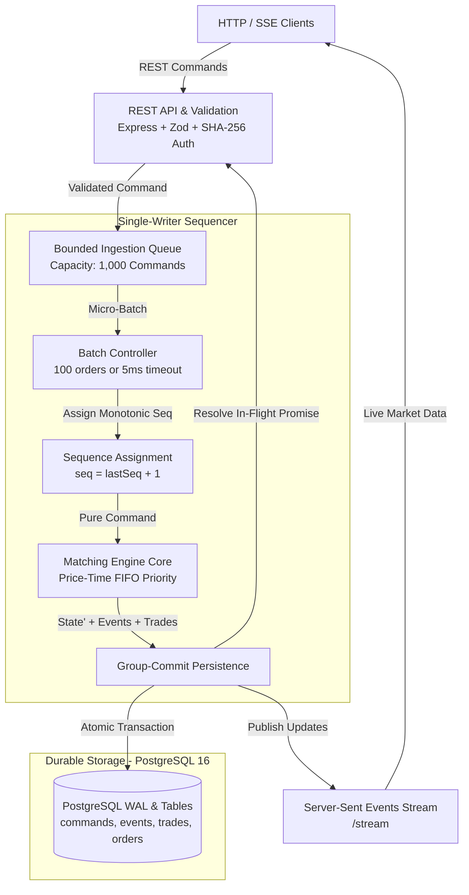
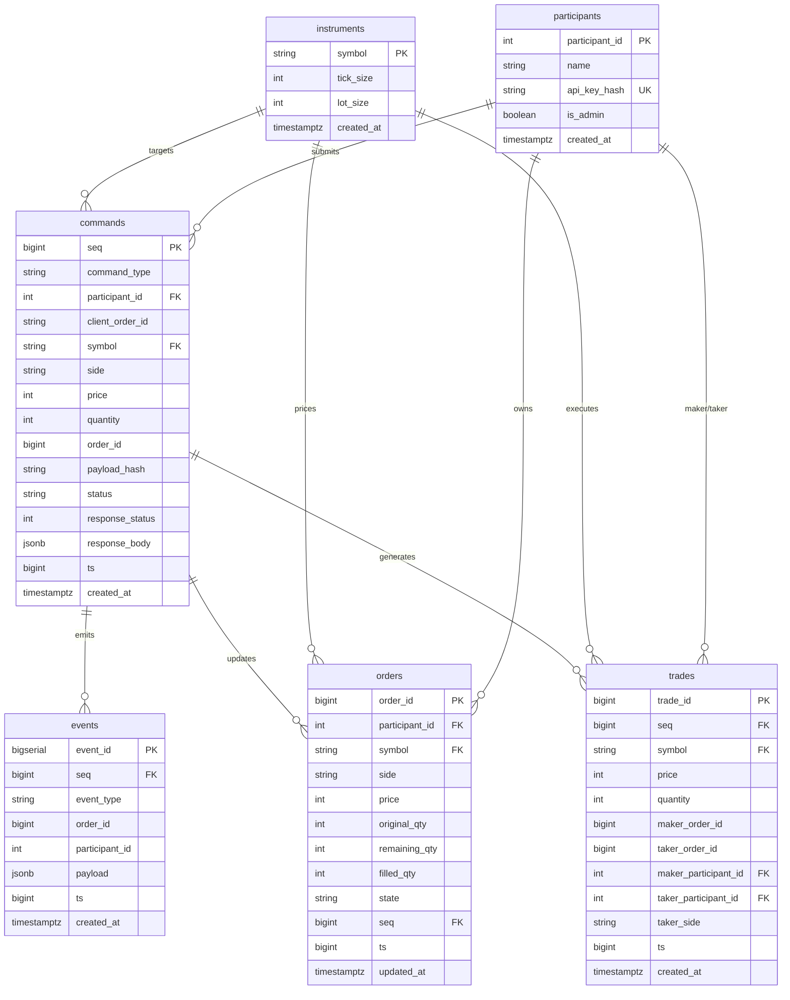

# DirectiveO9

DirectiveO9 is a deterministic limit-order-book matching engine featuring a durable PostgreSQL command journal, verifiable state replay, online invariant checking, and micro-batched group-commit sequencing.

---

## Problem Statement

Financial trading systems operate under strict trade-offs between execution latency, transaction durability, and operational auditability:

1. **Relational Database Bottlenecks**: Writing and locking relational tables on every individual trade creates disk I/O bottlenecks that cap throughput at low transaction rates.
2. **In-Memory Volatility**: Purely in-memory engines offer microsecond latencies but risk catastrophic data loss or undetected state corruption during unexpected host crashes or process terminations.
3. **Auditability and Verification**: Regulatory compliance and exchange operations require mathematical proof that the exchange state can be reconstructed bit-for-bit from an immutable audit trail without reliance on proprietary black-box database state.

DirectiveO9 solves this by decoupling state transitions as pure, deterministic functions `(state, command) -> (state', events)` managed by a single-writer sequencer. Commands are persisted to a durable PostgreSQL journal using group-commit micro-batching before client acknowledgment. The entire state can be replayed deterministically from sequence 1, verified against an independent reference oracle, and audited using canonical SHA-256 state hashes.

---

## Core Features

- **Deterministic Pure Matching Engine**: Integer prices and quantities (`Number.isSafeInteger` boundary checks), strict price-time priority (FIFO), and zero non-deterministic side effects (no system clocks or random numbers inside the matching core).
- **Comprehensive Order Types**: Full support for `LIMIT`, `MARKET`, `IOC` (Immediate-Or-Cancel), and `CANCEL` commands with multi-level liquidity sweeping and enumerated rejection codes.
- **Single-Writer Sequencer**: Contiguous, gap-free monotonic sequence numbers, bounded ingestion queuing with backpressure (HTTP 503 `QUEUE_FULL`), and in-memory LRU idempotency caching with concurrent in-flight request coalescing.
- **Group-Commit Journaling**: Micro-batched PostgreSQL transactions combining command journaling, event publishing, trade recording, and order projection updates within an atomic transaction block.
- **Bit-for-Bit Replay & Reference Oracle**: Independent naive reference engine (`test/oracle/naive-engine.js`) constructed with plain arrays and linear scans for unbiased differential verification, coupled with ADR 0002 canonical SHA-256 state hashing.
- **Continuous Invariant Auditing**: Six structural invariants evaluated continuously and during replay: uncrossed books, single order location, positive resting quantities, order quantity conservation, trade volume conservation, and gap-free sequence monotonicity.
- **Crash Durability & Fail-Stop Recovery**: Validated under 100-round chaos testing with unexpected process termination (`SIGKILL`) and transaction abort recovery.
- **Real-Time Operator Interface**: Built-in web dashboard (`ui/`) serving live L2 order book depth ladders, streaming trade tapes, event streams via Server-Sent Events (SSE), and one-click replay verification.

---

## System Architecture



Detailed architectural documentation covering the write path, replay path, recovery path, and failure handling is available in [docs/architecture.md](docs/architecture.md).

---

## Database Schema (ER Diagram)



---

## Quick Start

### 1. Prerequisites

- **Node.js**: >= 20.0.0
- **npm**: >= 10.0.0
- **Docker & Docker Compose** (or an existing PostgreSQL 16 server)

### 2. Installation

```bash
git clone https://github.com/Ayush-o1/DirectiveO9.git
cd DirectiveO9
npm ci
```

### 3. Database Setup

Start the local PostgreSQL container (mapped to host port `5433` by default to prevent port collisions):

```bash
docker compose up -d postgres
```

Run database migrations and seed default test instruments (`BTC-USDT`, `ETH-USDT`) and participants (`MM1`, `MM2`, `TRADER1`, `ADMIN`):

```bash
# If using custom PostgreSQL connection settings:
# export PGPORT=5433 PGUSER=postgres PGPASSWORD=postgres PGDATABASE=directiveo9
npm run db:migrate
npm run db:seed
```

### 4. Run the Automated Demo

The demo executes database migrations, seeds reference data, runs a scripted multi-participant trading session, prints the resulting L2 order book depth ladder, and executes a full replay verification against the independent naive reference oracle:

```bash
npm run demo
```

### 5. Start the Engine and Operator Dashboard

```bash
npm start
```

Open your browser at `http://localhost:3000` to access the interactive web dashboard. Default test API keys for order placement are listed in `scripts/seed.js` (e.g. `key_trader1_test_secret_3`).

### 6. Run Test Suite

```bash
# Execute standard test suite (deterministic fixtures, invariant tests, integration tests)
npm test

# Run tests with code coverage analysis
npm run test:coverage

# Run linter and formatting checks
npm run lint
npm run format:check

# Run extended property-based differential test (2,000 randomized command sequences)
npm run test:diff:long
```

---

## API Overview

The REST and streaming API provides order entry, market data inspection, and administrative replay verification. All order placement and management endpoints require authentication via the `x-api-key` header.

| Endpoint              | Method   | Authentication  | Description                                                   |
| :-------------------- | :------- | :-------------- | :------------------------------------------------------------ |
| `/orders`             | `POST`   | Participant Key | Submit `LIMIT`, `MARKET`, or `IOC` order                      |
| `/orders/:id`         | `DELETE` | Participant Key | Cancel resting order by order ID                              |
| `/orders/:id`         | `GET`    | Participant Key | Query order projection by order ID                            |
| `/book/:symbol`       | `GET`    | Public          | Fetch L2 order book depth ladder (`?depth=50`)                |
| `/trades`             | `GET`    | Public          | Query historical trade executions (`?symbol=&from_seq=`)      |
| `/events`             | `GET`    | Public          | Query emitted engine events (`?from_seq=`)                    |
| `/stream`             | `GET`    | Public          | Server-Sent Events (SSE) streaming depth snapshots and trades |
| `/health`             | `GET`    | Public          | Health check reporting database and sequencer status          |
| `/admin/instruments`  | `POST`   | Admin Key       | Register or update tradable instrument metadata               |
| `/admin/participants` | `POST`   | Admin Key       | Register participant credentials and API keys                 |
| `/admin/verify`       | `GET`    | Admin Key       | Validate 6 structural invariants against active memory state  |
| `/admin/replay`       | `POST`   | Admin Key       | Trigger on-demand journal replay and state hash audit         |

Complete endpoint specifications, request/response JSON schemas, and curl examples are documented in [docs/api.md](docs/api.md).

---

## Benchmarks & Empirical Methodology

Performance benchmarks are measured using reproducible scripts with explicit garbage collection and high-resolution timers (`process.hrtime.bigint`). All benchmark numbers are published directly from timestamped raw JSON result files in `bench/results/`.

- **In-Memory Engine Microbenchmark (`npm run bench:engine`)**: Measures pure matching throughput across 5 repetitions with 25,000 commands per run under shallow (10 levels), medium (500 levels), and deep (5,000 levels) book conditions, comparing the binary-search sorted array (`SortedArrayPriceIndex`) against the balanced AVL tree (`AVLTreePriceIndex`).
- **End-to-End API Benchmark (`npm run bench:api`)**: Evaluates HTTP ingestion capacity under durable PostgreSQL journaling (`synchronous_commit = on`) across varying micro-batch configurations (batch sizes 1, 20, 100) and measures maximum unconstrained system capacity before queue-full backpressure.
- **Recovery & Replay Benchmark (`npm run bench:recovery`)**: Profiles cold startup recovery time across 1,000, 5,000, and 20,000 journaled commands, measuring PostgreSQL fetch latency, in-memory engine replay throughput, event parity checking, and memory heap retention.

To view the complete empirical results, latency distributions (p50, p95, p99), hardware environment telemetry, and raw output tables, see [docs/benchmarks.md](docs/benchmarks.md).

---

## Limitations & Known Gaps

1. **Order Registry Memory Retention**: The in-memory matching engine retains all orders (`this.orders` Map) across their entire lifecycle, including after reaching terminal states (`FILLED`, `CANCELLED`, `REJECTED`). In long-running deployments, heap usage scales monotonically ($O(N)$) with cumulative order count. Production systems require periodic state snapshots and cold-storage archiving of terminal orders.
2. **Cold Startup Scaling**: Startup recovery replays the command journal from sequence 1 to reconstruct in-memory state. Recovery latency scales linearly ($O(N)$) with journal length. Checkpointing snapshotting is required to bound recovery time in high-volume environments.
3. **Self-Trade Prevention (STP)**: In the current version, crossing orders from the same participant trade against each other. Configurable STP policies (e.g. cancel maker, cancel taker) are planned for future releases.
4. **Filesystem Durability in Virtualized Environments**: Under Docker Desktop on macOS, host-to-VM disk caching can report PostgreSQL `fsync` completions before blocks are written to physical non-volatile storage. True durability guarantees require bare-metal Linux or native NVMe storage.

---

## Project Structure

```
DirectiveO9/
├── src/
│   ├── index.js              # Entrypoint and bootstrap lifecycle orchestration
│   ├── engine/               # Pure in-memory matching engine
│   │   ├── engine.js         # Multi-instrument matching pipeline and order matching logic
│   │   ├── book.js           # Single-instrument OrderBook state and depth projection
│   │   ├── level.js          # SortedArrayPriceIndex price-level index
│   │   ├── avl.js            # AVLTreePriceIndex balanced binary tree index
│   │   ├── queue.js          # Doubly linked list FIFO order queue
│   │   └── hash.js           # ADR 0002 SHA-256 canonical state hasher
│   ├── sequencer/            # Single-writer pipeline and persistence
│   │   ├── sequencer.js      # Group-commit micro-batching and sequence assignment
│   │   ├── idempotency.js    # In-memory LRU idempotency cache and payload hasher
│   │   └── replay.js         # Journal replay verification and oracle parity harness
│   ├── api/                  # HTTP REST API and streaming endpoints
│   │   ├── app.js            # Express application routing and SSE publisher
│   │   ├── routes.js         # Endpoint controllers (orders, books, trades, admin)
│   │   ├── schemas.js        # Zod validation schemas for request boundary
│   │   └── auth.js           # SHA-256 API key authentication middleware
│   └── db/                   # PostgreSQL connectivity and migrations
│       ├── pool.js           # pg.Pool configuration and environment defaults
│       └── migrator.js       # Atomic SQL migration runner
├── migrations/               # Plain SQL migration files
├── ui/                       # Real-time operator dashboard (HTML/CSS/JS)
├── scripts/                  # CLI tools: demo.js, seed.js, replay.js, chaos.js, bench-report.js
├── bench/                    # Benchmark harnesses (engine, api, recovery) and raw JSON results
├── test/                     # Test suites: fixtures, differential, integration, api-db, chaos
└── docs/                     # Specifications, architecture, benchmarks, and ADRs
```

---

## License

This project is licensed under the [MIT License](LICENSE).
